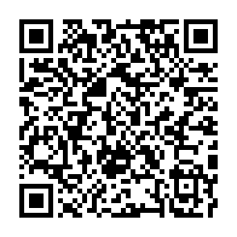
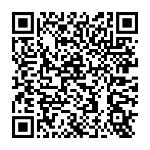

# Mario Kart Wii 3DS

A native Nintendo 3DS port of Mario Kart Wii, continued by **MiniBandit** from
the original port by **dudewhat**.

This is **ThePhilosophicalOne's fork** of MiniBandit's v0.5.2: a
retail-accuracy pass that makes the port behave like the Wii game. It's a
**work in progress**: expect bugs. Its builder and quick updates are separate
from MiniBandit's.

This repository contains **no Nintendo files**. It builds an installable CIA
on your own computer from your own Mario Kart Wii disc.

It isn't an emulator. The game runs natively on the 3DS: kart physics come from
[Kinoko](https://github.com/vabold/Kinoko), a recreation of Mario Kart Wii's
physics, and rendering, audio and menus are written for the 3DS hardware. The
builder converts the disc's courses, characters, vehicles, menus, movies and
sound into 3DS formats.

## What's new in this fork (v0.6.0)

Most changes were checked against the retail game's code (the source comments
cite the PAL addresses).

- **Time Trial ghosts**: your best time is saved as a ghost; copy any `.rkg` ghost to `sd:/3ds/mkw-3ds/ghosts` to race it; Watch the Replay
- **Course intros** as on the Wii: fades, the flyover, the course and cup title card; A skips
- **Sound**: the retail menu and race sound flow and fades, correct pitches, rank up/down sounds, character voices, the item warning alarm, dropped-item sounds
- **Driver animations**: finish poses, item throws, hit reactions
- **CPU racers**: retail vehicle choice, drifts with sparks and boosts, start boosts, recovery when stuck
- **Items**: Goombas drop Mushrooms, triple shells, item warning icons, item box textures, item shadows
- **Retail minimap** on the lower screen
- **Courses**: sharper textures, the shining sea on Koopa Cape and the other coastal courses
- **Menus**: faster pages, no dropped button presses, character and vehicle models as on the Wii
- Kinoko physics fixes for ghosts, Goombas and CPUs (`patches/kinoko-arm11.patch`)

Tested on the Azahar emulator. Please report how it runs on a real 3DS in [Issues](../../issues).

## What's new in this continuation

On top of dudewhat's original release (Solo VS, 24 drivers, the 6 starting
vehicles each):

- **Grand Prix** in 50cc (karts), 100cc (bikes) and 150cc: the cup's four courses in order, with points and standings
- **Time Trials**: solo, a Triple Mushroom, best time per course saved to the SD card
- **All 12 vehicles** for every driver, including the unlockables
- **Speedometer** on the race HUD (SELECT toggles it)
- **Tricks on Y** (the Circle Pad picks the direction) or the D-pad, also bike wheelies; R only hops and drifts, as on the Wii
- **Look behind** on X (Mario Kart 7 style) or ZL
- **Smoke and dust**: start-boost smoke, burnout, drift smoke, off-road dust, landing puffs
- **Balloon Battle** on all ten arenas, with CPU opponents, balloon scoring and a three-minute match
- Model and HUD fixes
- HOME Menu name and icon, and the standard Nintendo 3DS start-up logo

Still in progress: Mirror, Coin Runners and Team VS. Not yet: online play.

## What you need

- **Mario Kart Wii (USA)**, game ID `RMCE01`, dumped as `.iso` or `.wbfs`.
  Convert RVZ or NKit dumps to ISO in Dolphin first.
- About **15 GB** of free space and an internet connection
- [devkitPro](https://devkitpro.org/wiki/Getting_Started) with the 3DS tools (`3ds-dev`)
- [Python 3.11–3.14](https://www.python.org/downloads/) and [Node.js LTS](https://nodejs.org) (Python 3.15 is not supported yet)
- [Git](https://git-scm.com)
- macOS: Xcode command line tools (`xcode-select --install`)

## Building

**macOS:** double-click `Build MKW CIA.command`, drag your disc image into the
window and press Return.

**Windows:** double-click `Build MKW CIA.bat`, drag your disc image into the
window and press Enter. *(New: please report how it goes.)*

The first build takes about 30–60 minutes. Your CIA is saved to
`build/release/mkw-3ds.cia`. If a build stops partway, run it again: finished
steps are skipped. If it fails, share `build-cia-log.txt` when asking for help.

## Installing

You need a 3DS with custom firmware ([3ds.hacks.guide](https://3ds.hacks.guide)).

1. Copy `mkw-3ds.cia` to your SD card and install it with FBI.
2. For sound, run DSP1 once to dump your sound firmware.

New 3DS / New 2DS run at 60 FPS (30 FPS with the 3D slider up); Old 3DS / 2DS at 30 FPS.

**Please don't share built CIAs**: they contain Nintendo's game files. Share this builder instead.

## Quick updates (no rebuilding)

### Who can use the QR code, and who has to build

| You are… | What to do |
|---|---|
| **Built your game with this fork's builder, v0.6.0 or newer** and copied `build/release/sd-card/3ds` to your SD card | ✅ **Scan the QR code below.** That's all. |
| **Built with MiniBandit's builder** (any version) | ❌ **The QR code will NOT work for you.** This fork converts the game files differently. Download this fork's builder from the [latest release](../../releases/latest), build the game again and install the full CIA. After that, later updates are quick updates. |
| **Never built the game** (no CIA from your own disc) | ❌ **The QR code is not the game.** It is a small update of a game you build yourself from your own Mario Kart Wii disc. Without a built game and its SD files it only shows a "build the game first" message. Use the builder. |
| **Built with v0.6.0 or newer but didn't copy the SD folder** | ❌ Copy `build/release/sd-card/3ds` to the **root of your SD card** first, then scan. |

MiniBandit's QR codes and store install MiniBandit's updates: don't use them on a
game built with this fork.

If you're unsure which version you built with, **build again with the latest
builder**: it always works. The game also tells you on start-up when its files
are too old for an update.

### How to update

**Once:** copy the folder **`build/release/sd-card/3ds`** from the builder to the
**root of your SD card** (it adds the converted game files as `sd:/3ds/mkw-3ds`).

**Then, for every update**, install the small **update CIA** (about 2 MB, no
game files) in one of these ways:

| | |
|---|---|
| **FBI**: Remote Install → Scan QR Code |  |
| **Universal-Updater**: Settings → Add store → scan this, then install *Mario Kart Wii 3DS (update)* whenever there's a new version |  |
| **Manually**: download `MKW-3DS-Update.cia` from the [latest release](../../releases/latest) and install it with FBI | |

The update installs over your game like any CIA update: your saves and SD files
stay. After an update, the game shows what's new on its first launch.

The QR codes always fetch the newest update. If an update ever needs newer game
files, the game tells you on start-up: download the latest builder, build again
and copy `build/release/sd-card/3ds` to your SD card again.

## Controls

| Button | Action |
|---|---|
| Circle Pad | Steer; up/down when using an item throws forward/back |
| A | Accelerate |
| B | Brake / reverse |
| R | Hop and drift |
| X (or ZL) | Look behind |
| Y | Trick (Circle Pad picks the direction) / bike wheelie |
| D-pad | Trick / wheelie (Wii Classic Controller style) |
| L | Use item |
| START | Pause |
| SELECT | Speedometer on/off |
| Touch screen | Switch the bottom-screen map view |

On the Wii a trick is a shake of the Wii Remote. The 3DS has no equivalent, so Y and the D-pad stand in for it.

## Contributing

Bug reports and suggestions go in [Issues](../../issues). Pull requests are welcome.
Please test changes on an emulator (Azahar) or real hardware before submitting.

## Credits

- **dudewhat**: the original Mario Kart Wii 3DS port and CIA builder this project continues
- **MiniBandit**: this continuation
- **ThePhilosophicalOne**: this fork's retail-accuracy pass
- **Epic0522**: graphics upgrades: lighting, kart shadows, water, effects and menu highlights; upstream's race overhaul was the guide for this fork's crates, Wiggler, item boxes on moving roads and Bowser statues
- **DarthMDev**: Old 3DS drawing performance fix
- **Codiak540**: Old 3DS performance testing (course-object detail distance, particle limit)
- [Kinoko](https://github.com/vabold/Kinoko) by vabold (MIT): Mario Kart Wii physics
- [noclip.website](https://github.com/magcius/noclip.website) (MIT): BRRES model reading
- [gclib](https://github.com/LagoLunatic/gclib) by LagoLunatic (MIT): disc and texture tools
- [citro3d](https://github.com/devkitPro/citro3d) by fincs (zlib): 3DS graphics
- [ogws](https://github.com/doldecomp/ogws) and [mkw](https://github.com/snailspeed3/mkw) decompilation references (CC0)
- [makerom](https://github.com/3DSGuy/Project_CTR) and [bannertool](https://github.com/Epicpkmn11/bannertool) for packaging

Mario Kart Wii is © Nintendo. This is an unofficial fan project with no
affiliation with Nintendo. See [NOTICE](NOTICE) for licensing.
